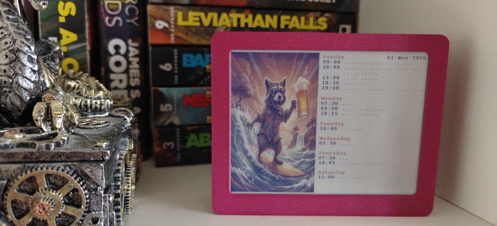
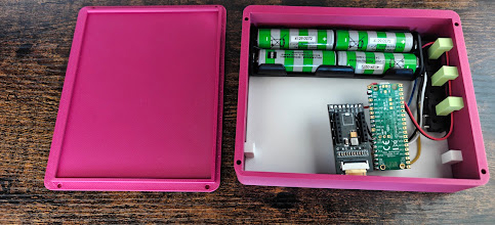
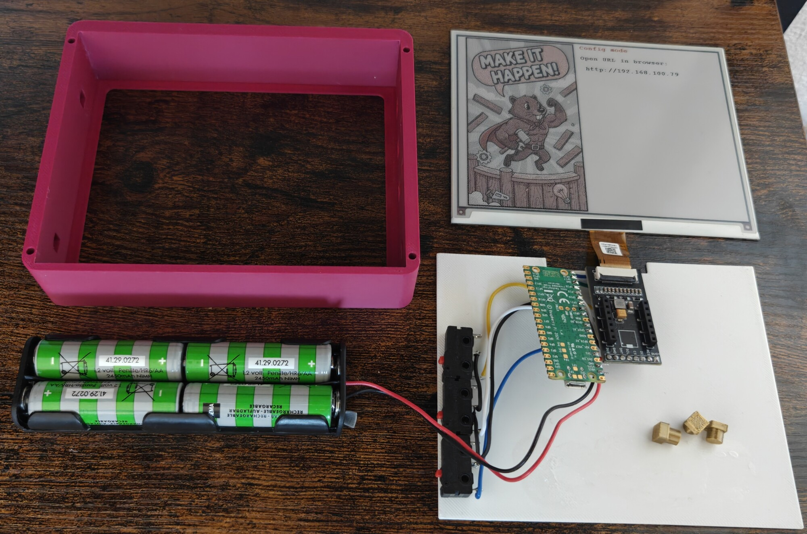
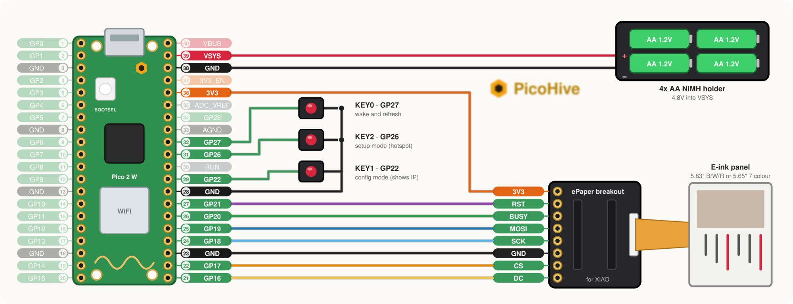

# Standalone Raspberry Pi Pico 2 W E-Paper calendar

Just grab calendars from google and show next week items with a funny picture\
Runs for 2 months on 4 AA Batteries

### Easy to check in the morning when it's hectic

### Simple build, few components

### Assembly, careful with ribbon cable, I broke this during disassembly

# Flashing and configuring

Check releases - two variants
- `epaper_color.uf2` - 5.65" 7 colour panel, 600x448 (Waveshare Pico-ePaper-5.65)
- `epaper_rb.uf2` - 5.83" black/white/red panel, 648x480 (Waveshare Pico-ePaper-5.83 (B))

Once flashed it will start in setup mode `picow_config` / `randompassword` ( http://192.168.4.1 ) \
Press KEY2 (GP26) to enter setup mode again\
Press KEY1 (GP22) to enter config mode and access on LAN

Any iCal URL works (Google, Nextcloud, ...) \
It has a lot of goodies from [picohive-firmware](https://github.com/AdrianCX/picohive-firmware) like OTA, logs, crash reports ...\
You can set your own pictures from the web page, it dithers them itself

# Funny pictures

Some pictures to start with, click one for the full size, save it and upload it from the web page:

|   |   |   |   |   |   |
|---|---|---|---|---|---|
|  |  |  |  |  |  |
|  |  |  |  |  |  |
|  |  |  |  |  |  |

# How to get a calendar address from google

1. Open on desktop site [calendar.google.com](https://calendar.google.com)
2. Hover over calendar in "My calendars" and press the 3 dots then "Settings and Sharing"
3. Scroll down to "Secret address in iCal format" and copy that
4. Paste the calendar in the web page, save and reboot for it to be grabbed.

Notes:
- Web page stores config encrypted, doesn't echo or print it
- Calendar is fetched over HTTPS with root cert verification, only attack is someone taking calendar and reflashing firmware
- If you think it's leaked - there's a Reset button in google calendar to invalidate it

> [!TIP]
> To wipe it, flash [`flash_nuke.uf2`](https://github.com/Gadgetoid/pico-universal-flash-nuke) then the firmware again

# Building it yourself

Check out docs in [picohive-firmware](https://github.com/AdrianCX/picohive-firmware)

# How to build one

About 30€ for the red/black/white version, 45€ for the 7 colour one, plus printing (see 4.2):

| Part | Price |
|---|---|
| E-ink panel, one of: 5.83" black/white/red (648x480) or 5.65" 7 colour (600x448) | 15€ / 30€ |
| Raspberry Pi Pico 2 W | 9€ |
| [ePaper breakout board for XIAO](https://www.kiwi-electronics.com/en/epaper-breakout-board-for-xiao-20056?country) | 5€ |
| 4xAA battery holder with wires (NiMH rechargeables) | - |
| 3 push buttons, some wire | - |
| 3D printed frame, back and supports | - |

The holders plug into holes in the support, it all comes together without any screws. Use some superglue or tape and you're set.
If you need to adjust parts check out stl/scad folder - openscad is awesome

# 3D printed parts

Files in [stl/](stl/), each with its OpenSCAD source under the same name in [stl/scad/](stl/scad/):

| File | Count | What |
|---|---|---|
| [1_main.stl](stl/1_main.stl) | 1 | frame, holds the screen |
| [2_back.stl](stl/2_back.stl) | 1 | back cover |
| [3_small_foot.stl](stl/3_small_foot.stl) | 1 | short support |
| [4_button.stl](stl/4_button.stl) | 3 | button caps |
| [5_feet.stl](stl/5_feet.stl) | 2 | normal supports |
| [6_long_feet.stl](stl/6_long_feet.stl) | 3 | long supports |
| [7_screen_support.stl](stl/7_screen_support.stl) | 1 | plate behind the screen, the notch goes over the ribbon cable |

# Wiring

- Panel: see actual picture for ribbon cable - don't plug it wrong way
- GPIOs: just follow picture above
- Battery holder: red to VSYS, black to GND

> [!WARNING]
> Careful with the ribbon cable, it's very easy to break where it joins the screen and make it unresponsive

You can adjust pins in `src/config/general_config.h`, if you wire it differently.\

## License

AGPL-3.0-or-later for this app, see [LICENSE](LICENSE). The `os/` submodule is MPL-2.0, see its LICENSE.
